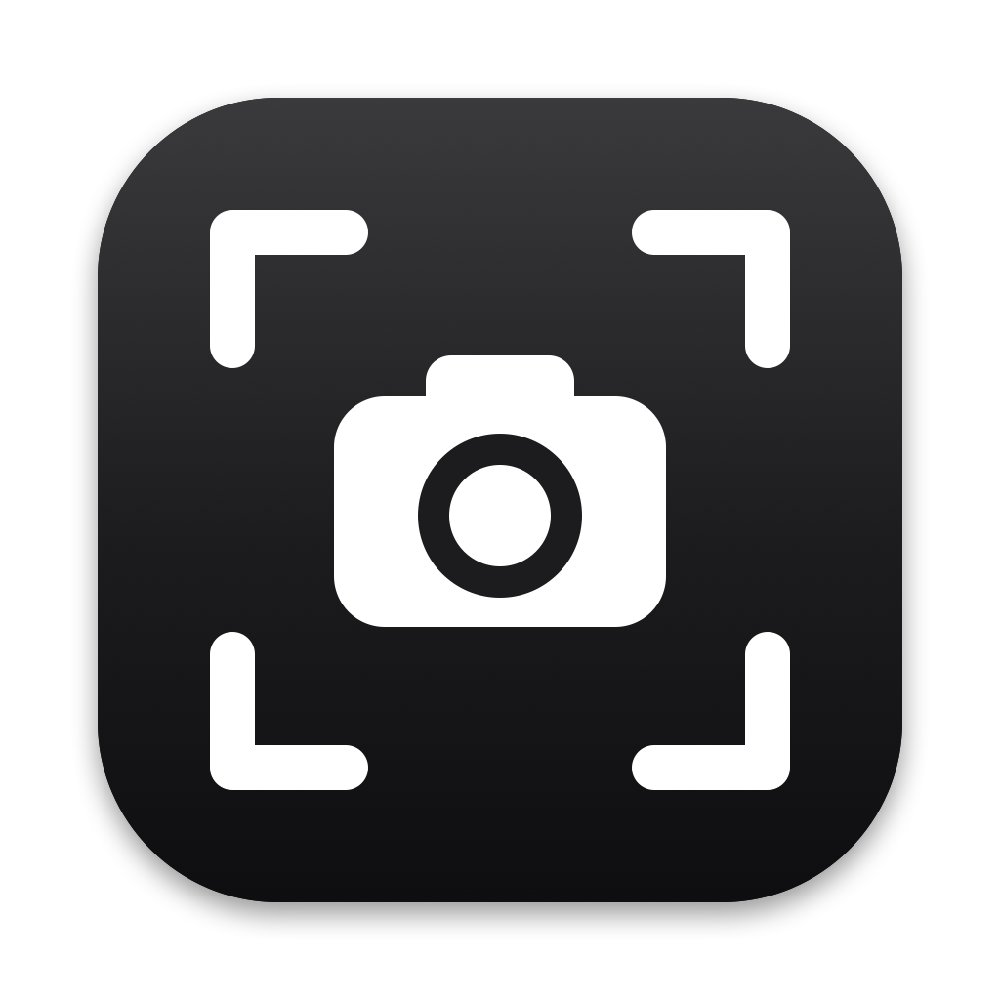

<p align="center">
  
</p>

<h1 align="center">MacScreenshot</h1>

<p align="center">
  <b>Freeze, select, done.</b> A fast, native screenshot tool for macOS:<br>
  the simple Greenshot / Flameshot alternative for Mac.
</p>

<p align="center">
  <a href="https://github.com/CJayXYZ/MacScreenshot/releases/latest">Download</a> ·
  <a href="#how-to-use">How to use</a> ·
  <a href="https://github.com/CJayXYZ/MacScreenshot/issues/new/choose">Feedback</a> ·
  <a href="https://github.com/sponsors/CJayXYZ">Sponsor ♥</a> ·
  <a href="https://ko-fi.com/cjayxyz">Ko-fi ☕</a>
</p>

---

Press **⌘⇧X** and the screen freezes instantly, so menus, tooltips and video frames stay exactly where they were. Drag a region, and it's **saved as a file and copied to your clipboard** in one go. No editor windows, no clicks in between.

- **Freeze-frame capture.** What you see when you press the shortcut is what you get.
- **Pixel-precise magnifier.** A loupe follows the pointer with exact coordinates and the selection size in pixels.
- **Saved and copied every time.** Paste straight into Slack, Mail, Figma or a browser.
- **Quick edits (⌃⇧⌘X).** Crop, arrows, boxes, text and highlights, then save or replace.
- **Capture last region (⌘⌥⇧X).** Re-shoot the same area instantly, perfect for before/after shots.
- **Smart file names.** For example, `screenshot-2026-10-17_15-08-12-Google Chrome-GitHub - Pull request.png`
- **PNG or JPEG** with a 0–100% quality slider.
- **Your folder.** Uses the macOS screenshot folder, or any folder you pick.
- **Your shortcuts.** Change both capture shortcuts to any combination you like.
- **Always there.** Lives in the menu bar, starts at login, restarts itself if it ever crashes.
- **Light.** Native Swift, about 1 MB download, ~15 MB of memory when idle. No Electron, no ads, no tracking, no network access.

## Install

1. Download **MacScreenshot-x.y.z.zip** from the [latest release](https://github.com/CJayXYZ/MacScreenshot/releases/latest), unzip it, and drag **MacScreenshot.app** into **Applications**.
2. Open it. Because this build isn't notarized by Apple yet, macOS will block the first launch:
   - Open **System Settings → Privacy & Security**, scroll down, and click **Open Anyway** next to MacScreenshot.
   - Or, in Terminal: `xattr -dr com.apple.quarantine /Applications/MacScreenshot.app`
3. Allow **Screen Recording** when asked (System Settings → Privacy & Security → Screen & System Audio Recording), then quit and reopen MacScreenshot from its menu bar icon.

Requires macOS 14 Sonoma or later, on Apple Silicon or Intel.

## How to use

| Shortcut | What it does |
| --- | --- |
| **⌘ ⇧ X** | Freeze the screen and show the crosshair and magnifier |
| Drag and release | Save the selection and copy it to the clipboard |
| **⌘ A** (while frozen) | Capture the whole screen instead |
| **Esc** (while dragging) | Clear the selection and drag again |
| **Esc** (again) | Back to the live screen, nothing saved |
| **⌘ ⌥ ⇧ X** | Capture the same area as last time, instantly |
| **⌃ ⇧ ⌘ X** | Edit the last capture |

### Editing

Press **⌃⇧⌘X** to open your latest capture in a simple editor:

- **Crop (C)**, **Arrow (A)**, **Box (B)**, **Circle (O)**, **Text (T)** and **Highlight (H)**
- Thin, medium or thick lines; text in four sizes and three weights (regular, bold, heavy)
- 7 colours, plus undo/redo (⌘Z / ⇧⌘Z)
- **Save** keeps the original and adds an `-edited` copy. **Replace** overwrites the original. Both copy the result to the clipboard.

To change the shortcuts, open the menu bar icon → **Keyboard Shortcuts…**, click a shortcut and press the new combination.

Everything else is in the **menu bar icon**:

- Save as PNG or JPEG, and the JPEG quality
- Shutter sound on/off and its volume
- Where screenshots are saved
- Start at login
- How to Use
- Send Feedback

**Can't see the menu bar icon?** It can hide behind the MacBook notch, or be switched off in System Settings → Menu Bar. Open MacScreenshot again from Applications or Spotlight: the icon comes back and a window opens with the full menu.

## Build from source

```bash
git clone https://github.com/CJayXYZ/MacScreenshot.git
cd MacScreenshot
./build.sh --install   # builds, copies to /Applications, starts it
```

Needs the Xcode command line tools (Swift 5.10+). `./build.sh --release` makes a universal (Apple Silicon + Intel) zip. The app icon is drawn in code: `swift scripts/make-icon.swift Resources/Icon/icon_1024.png`.

## Feedback and ideas

This is v1.0, deliberately simple. Tell me what you'd like next (annotations, window capture, pin to screen, OCR…):

- 🐞 [Report a bug](https://github.com/CJayXYZ/MacScreenshot/issues/new?template=bug_report.yml)
- 💡 [Request a feature](https://github.com/CJayXYZ/MacScreenshot/issues/new?template=feature_request.yml)

## Support the project

MacScreenshot is free, open source, and ad-free, and it will stay that way. If it saves you time, you can support its development:

- ♥ [GitHub Sponsors](https://github.com/sponsors/CJayXYZ): monthly or one-time
- ☕ [Ko-fi](https://ko-fi.com/cjayxyz): a one-time tip, no account needed
- ⭐ Star the repo; it helps others find it

## License

[MIT](LICENSE) © CJayXYZ

---

<sub>Built with the help of AI coding tools.</sub>
